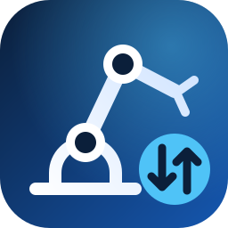

<p align="center">
  
</p>

<h1 align="center">YASKAWA YRC 1000 Downloader</h1>

<p align="center">
  <b>Download and upload jobs and data from and to YASKAWA YRC1000 robot controllers via FTP – right inside VS Code.</b>
</p>

<p align="center">
  <a href="https://github.com/Gtz187/yrc1000-downloader/actions/workflows/ci.yml"></a>
  <a href="https://github.com/Gtz187/yrc1000-downloader/releases"></a>
  <a href="LICENSE"></a>
  
  
</p>

<p align="center">
  <a href="#features">Features</a> ·
  <a href="#installation">Installation</a> ·
  <a href="#getting-started">Getting started</a> ·
  <a href="#commands">Commands</a> ·
  <a href="#settings">Settings</a> ·
  <a href="#development">Development</a>
</p>

---

Browse the controller like a folder, open jobs read-only, compare them with your local copy and upload changes with one click. Includes syntax highlighting for INFORM jobs (`.JBI`).

> [!NOTE]
> **Unofficial.** This extension is not affiliated with, endorsed by or supported by YASKAWA Electric Corporation. YASKAWA and MOTOMAN are trademarks of their respective owners.

## Features

| | |
| --- | --- |
| 🗂️ **Controller view** | Own entry in the activity bar. Browse `JOB`, `DAT`, `CND`, `SYS`, `PRM` and the other folders; click a file to open it straight from the controller, read-only. |
| ⬇️ **Download** | Single files, several files, whole folders – or your default folders with one click. |
| ⬆️ **Upload to Robot** | From the Explorer, the editor tab or the editor context menu. You confirm before anything is written to the controller. |
| 🛟 **Safe upload with automatic restore** | The YRC1000 deletes a job it rejects (e.g. syntax error). Before every upload the current version is backed up; if the upload is rejected, the original is written back automatically and you see the controller's error message. |
| 🔍 **Compare with Robot** | Differences between your local file and the controller version in the VS Code diff editor. |
| 🤖 **Multiple controllers** | Guided setup; the status bar shows the active controller and switches with one click. |
| 🎨 **INFORM syntax highlighting** | Instructions, motion commands, variables, labels, comments and position data in `.JBI` jobs. |
| 🔐 **Secure by default** | Passwords live in the VS Code secret storage. Optionally a `password` in `settings.json` takes precedence – remember that file is plain text. |
| 🧾 **Byte-exact transfers** | Binary mode – line endings and encoding stay untouched. |
| ⚡ **Upload on save** | Optional, for fast teach-and-test cycles. |
| 🌐 **English and German** | User interface in both languages. |

### Why a dedicated extension?

The FTP server of the YRC1000 sends a non-standard directory listing and supports neither `EPSV` nor `MLSD`. General-purpose FTP extensions therefore show empty folders. This extension ships its own FTP client, built and tested for exactly this server.

## Installation

1. Download the latest `.vsix` from the [Releases](https://github.com/Gtz187/yrc1000-downloader/releases) page.
2. In VS Code: **Extensions** view → `…` menu → **Install from VSIX…**, or on the command line:

   ```bash
   code --install-extension yrc1000-downloader-<version>.vsix
   ```

## Getting started

1. Open a folder for your robot project.
2. Click the **robot icon** in the activity bar, then **Add Robot Controller**.
3. Enter a name, the IP address of the controller, the FTP user and the password.
4. Done – the controller's folders appear in the view.

**Requirements:** FTP must be enabled on the controller, and your PC needs an IP address in the controller's network.

### Local folder layout

Local files mirror the controller:

```
<workspace>/
├─ JOB/
│  ├─ MAIN.JBI      ⇄  controller: /JOB/MAIN.JBI
│  └─ …
└─ DAT/
   └─ …
```

If a workspace has several controllers, each one gets its own subfolder, for example `Robot 2/JOB/…`. You can change this with `localFolder`.

## Commands

All commands are in the Command Palette under **YRC1000:**.

| Command | What it does |
| --- | --- |
| Add Robot Controller… | Guided setup for a new controller |
| Switch Controller… | Changes the active controller (also via the status bar) |
| Download Default Folders | Downloads the folders in `downloadFolders` (default: `JOB`) |
| Download Folders… | Choose which controller folders to download |
| Upload to Robot | Uploads the selected files or folder, or the active file |
| Compare with Robot | Diff between the local file and the controller version |
| Open Upload Backups | Shows the backups taken before each upload |
| Test Connection | Connects and lists the controller folders |
| Set FTP Password… / Clear Stored FTP Password | Manage the stored password |
| Show Log | FTP log. Set the log level to *Debug* to see the full FTP conversation (passwords are masked). |

## Settings

The guided setup writes the controllers to `.vscode/settings.json` of your workspace:

```jsonc
{
  "yrc1000.controllers": [
    { "name": "Cell 1", "host": "192.168.255.1", "username": "ftpuser" },
    { "name": "Cell 2", "host": "192.168.255.2", "username": "ftpuser", "localFolder": "cell2", "downloadFolders": ["JOB", "DAT"] }
  ],
  "yrc1000.downloadFolders": ["JOB", "DAT", "CND"],
  "yrc1000.confirmUpload": true,
  "yrc1000.uploadOnSave": false
}
```

| Setting | Default | Description |
| --- | --- | --- |
| `yrc1000.controllers` | `[]` | Controllers: `name`, `host`, `port` (21), `username`, `password` (optional), `localFolder`, `downloadFolders` |
| `yrc1000.downloadFolders` | `["JOB"]` | Default folders for *Download Default Folders* |
| `yrc1000.confirmUpload` | `true` | Ask before uploading |
| `yrc1000.uploadOnSave` | `false` | Upload files in controller folders automatically when they are saved |
| `yrc1000.timeout` | `15000` | Timeout in ms for connecting and for controller replies |

> [!TIP]
> Settings in the **Workspace** tab (`.vscode/settings.json`) override the **User** tab. If changing a value in the Settings UI has no effect, check that you are editing it in the Workspace tab.

> [!WARNING]
> If you put a `password` into `settings.json`, do not commit that file to a public repository.

## Notes on the controller

- Depending on its state and settings, the controller may reject uploads – for a job with a syntax error (`451 Error closing file.--[5110]--`), while a job is running or selected, or when overwriting existing files is not allowed. The controller then deletes the file; the extension restores the previous version automatically and shows the controller's error message.
- Backups of replaced files: **YRC1000: Open Upload Backups**. The last 50 uploads per controller are kept.
- The YRC1000 reports a size of 0 for all files. This is normal.
- Hidden files and folders such as `.vscode` or `.git` are never uploaded.

## Safety

> [!CAUTION]
> Uploading files changes the robot controller. Check uploaded jobs on the teach pendant before running them, and follow the safety rules for your machine. Use at your own risk.

## Development

```bash
npm install
npm test          # compiles and runs the unit tests (including a mock YRC1000 FTP server)
npm run lint
npm run package   # creates the .vsix
```

Press `F5` in VS Code to start an Extension Development Host.

Pushing a tag such as `v1.2.0` runs the release workflow, which builds the `.vsix` and attaches it to a GitHub release (see [`.github/workflows/release.yml`](.github/workflows/release.yml)).

## License

[MIT](LICENSE) © 2026 Gtz187
